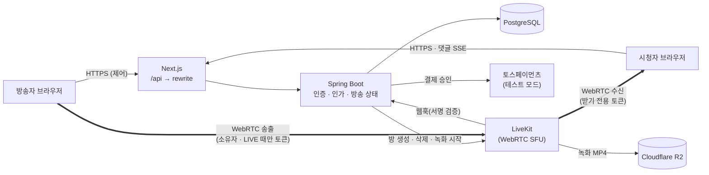

# 지이잉 (live-platform)

[](https://github.com/codes-gy/live-platform/actions/workflows/ci.yml)

PC 화면 공유나 휴대폰 카메라로 라이브 방송을 송출하고, 다른 기기에서 로그인 없이 실시간으로 시청하는 웹 서비스입니다. 코드밋 공모전 제출작으로 혼자 만들었습니다(2026.11).

| | |
|---|---|
| 서비스 주소 | https://onair-live-web-28fc2f0d1715.herokuapp.com |
| 운영 | 상시 운영(Heroku + Neon PostgreSQL). 오래 접속이 없었다면 첫 요청이 1~2초 늦을 수 있습니다(DB 대기 해제) |
| API 문서 | [Swagger UI](https://onair-live-api-daf462a2a9af.herokuapp.com/swagger-ui/index.html) (운영 백엔드) |
| 테스트 계정 | 아래 [테스트 계정](#테스트-계정) |
| 포트폴리오 상세 | https://ji-geunyeong.kro.kr/projects/live-platform |
| 관련 글 | [방송자 한 명, 시청자 여럿: WebRTC SFU와 LiveKit](https://velog.io/@codes-gy/WebRTC-SFULiveKit가-뭔가요) · [방송이 끝났는지는 누가 알까요: LiveKit 웹훅으로 방송 상태 맞추기](https://velog.io/@codes-gy/방송이-끝났는지는-누가-아는가-Spring-Boot와-LiveKit으로-라이브-방송-상태-관리하기) |
| 시연 영상 | 링크 추가 예정 |

## 주요 기능

| 영역 | 기능 |
|---|---|
| PC 방송 | 화면(탭 · 창 · 전체 화면) 공유 + 탭/시스템 소리 + 마이크 동시 송출(최대 1080p 60fps), 송출 중 화면 바꾸기 · 마이크 음소거, 마이크 음량 표시 |
| 모바일 방송 | 휴대폰 카메라 + 마이크 송출, 전면/후면 카메라 전환, 방송 중 화면 꺼짐 방지 |
| 시청 | 목록(방송 중 · 전체 · 종료, 송출 화면 썸네일 30초마다 갱신) → 상세에서 바로 재생, 로그인 불필요, 시청자 수 · 소리 켜기 · 전체 화면 |
| 방송 관리 | 등록 · 수정 · 삭제, 상태 `방송 전 → 방송 중 → 종료`, 종료 시 송출 연결 즉시 끊김, 새로고침해도 30초 안에 "방송 재개" |
| 인증 · 인가 | 회원가입 · 로그인 · 로그아웃(JWT HttpOnly 쿠키), 프로필 사진, 수정 · 삭제 · 송출 제어는 서버가 소유자 확인 |
| 댓글 (선택) | 방송별 실시간 댓글(SSE), 작성자만 수정, 작성자 · 방송자가 삭제 |
| 도네이션 (선택) | 토스페이먼츠 **테스트 모드**(실제 결제 없음) |
| 녹화 · 다시보기 (선택) | 방송 자동 녹화(LiveKit Egress → Cloudflare R2), **다시보기** 목록 · 재생 |

## 핵심 문제 해결

### 1. 끝났는지 모르는 방송 닫기
- **문제**: 방송자가 창을 닫거나 연결이 끊기면 종료 버튼이 눌리지 않아, 서버는 방송이 끝난 것을 알 수 없습니다.
- **원인**: 시청자가 한 명이라도 남아 있으면 LiveKit 방이 닫히지 않아 `room_finished` 웹훅이 오지 않습니다. 서버를 재시작하면 메모리에 둔 유예 예약도 사라집니다.
- **해결**: 방송자가 나갔다는 웹훅을 받으면 30초 뒤 방송자가 방에 있는지 다시 확인해 없으면 종료합니다. 웹훅이 유실되거나 서버가 재시작돼도 1분마다 LIVE 방송을 LiveKit 참가자와 맞춰 보고, 상태는 DB의 시작 시각과 LiveKit에서만 읽어 다음 주기에 다시 찾습니다.
  [`BroadcastLiveService`](backend/src/main/java/com/gy/live/broadcast/BroadcastLiveService.java) (`onParticipantLeft`, `reconcileLive`) · [`LiveReconcileScheduler`](backend/src/main/java/com/gy/live/broadcast/LiveReconcileScheduler.java) · 설정 `broadcaster-grace: 30s`, `reconcile-interval: 1m`([`application.yaml`](backend/src/main/resources/application.yaml))
- **결과**: 주기를 5초로 줄여 실제 LiveKit Cloud에 띄우고 방송자 없이 방송을 시작하자 63초 뒤 `ENDED`가 됐습니다(시작 유예 30초 + 주기 5초 이내 + 재확인 30초, [`PROGRESS.md`](PROGRESS.md) 기록). 경우별 동작은 [`LiveReconcileTest`](backend/src/test/java/com/gy/live/broadcast/LiveReconcileTest.java)(7개)와 [`LiveKitWebhookControllerTest`](backend/src/test/java/com/gy/live/broadcast/LiveKitWebhookControllerTest.java)(9개)로 확인합니다.

### 2. 종료가 겹쳐도 한 번만
- **문제**: 소유자의 종료, 웹훅, 1분 점검이 거의 동시에 오면 방송을 두 번 끝내거나, LiveKit 호출이 실패해 상태가 어긋날 수 있습니다.
- **해결**: 상태를 바꿀 때는 `findForUpdateById`로 방송 행을 잠그고 LIVE일 때만 ENDED로 바꿉니다. 종료 경로 넷(소유자 · 웹훅 · 유예 만료 · 주기 점검)은 모두 `endLocked` 한 곳을 지나고, LiveKit 호출은 트랜잭션 밖에서 합니다. 시작은 방을 먼저 만든 뒤 LIVE로 바꾸고, 종료는 ENDED로 바꾼 뒤 방을 닫습니다.
  [`BroadcastRepository`](backend/src/main/java/com/gy/live/broadcast/BroadcastRepository.java) · [`Broadcast`](backend/src/main/java/com/gy/live/broadcast/Broadcast.java) (`start()` · `end()`)
- **결과**: 웹훅이 중복되거나 순서가 바뀌어도 방송은 한 번만 종료되고(테스트 `같은_웹훅이_다시_와도_결과가_같다`), 방 만들기가 실패하면 READY로 남아(502) "LIVE인데 방이 없는" 상태가 생기지 않습니다.

### 3. 송출 권한은 토큰으로
- **문제**: 시청자가 송출 토큰을 흉내 내거나 남의 방송을 제어할 수 있으면, 로그인 없이 보게 한 의미가 없습니다.
- **해결**: 송출 토큰은 방송 소유자에게 LIVE일 때만 발급하고, 시청 토큰은 `CanPublish(false)`인 받기 전용으로 발급합니다([`LiveKitTokenIssuer`](backend/src/main/java/com/gy/live/livekit/LiveKitTokenIssuer.java)). 소유자 확인은 서비스 계층 한 곳(`BroadcastService.findOwned`)으로 모았습니다. 종료하면 LiveKit 방을 지워 연결을 강제로 끊습니다.
- **결과**: 비로그인 · 소유자 · 다른 사용자별 허용과 거절을 [`BroadcastLiveControllerTest`](backend/src/test/java/com/gy/live/broadcast/BroadcastLiveControllerTest.java) 등 통합 테스트와 브라우저 E2E([`auth.spec.ts`](frontend/e2e/auth.spec.ts))로 확인합니다.

## 구조



- **제어와 미디어를 분리**했습니다. 로그인 · 방송 CRUD · 송출 시작/종료처럼 권한 판단이 필요한 일은 모두 Spring을 거치고, 영상 · 음성은 브라우저와 LiveKit 사이로만 흐릅니다.
- 방송 상태 전이는 엔티티 한 곳(`Broadcast.start()` · `end()`)에만 있고, 상태 변경은 비관적 잠금으로 직렬화합니다.
- 다시보기는 비공개 R2 버킷에서 요청마다 2시간짜리 서명 주소를 만들어 재생합니다([`R2RecordingStorage`](backend/src/main/java/com/gy/live/recording/R2RecordingStorage.java)).

자세한 설계 문서:
- [`docs/ARCHITECTURE.md`](docs/ARCHITECTURE.md) — 구성도, 요청 경로, 패키지 구조, 배포, 환경변수
- [`docs/DESIGN.md`](docs/DESIGN.md) — ERD, 상태 머신, 인가 표, API 목록, 시퀀스, 결정 이유, 알려진 한계
- [`docs/DEPLOY.md`](docs/DEPLOY.md) — 운영 배포 절차 · 배포 후 확인 · 되돌리기
- [`docs/REQUIREMENTS.md`](docs/REQUIREMENTS.md) — 공모전 요구사항 항목별 구현 상태

## 기술 스택과 고른 이유

| 영역 | 사용 기술 |
|---|---|
| Backend | Java 25, Spring Boot 4.1, Spring Security(JWT HttpOnly 쿠키), Spring Data JPA, PostgreSQL 18, Flyway, springdoc(Swagger) |
| Frontend | Next.js 16 (App Router), React 19, TypeScript, Tailwind CSS 4 |
| Streaming | LiveKit (WebRTC SFU) — `livekit-client`, `@livekit/components-react`, `livekit-server` Java SDK |
| Test | JUnit 5, Testcontainers(PostgreSQL), MockMvc, Playwright(E2E) |
| Infra | Heroku(컨테이너), Neon(PostgreSQL), LiveKit Cloud, Cloudflare R2, GitHub Actions(CI) |

주요 결정([`docs/DESIGN.md`](docs/DESIGN.md) 8절):

| 결정 | 이유 | 버린 대안 |
|---|---|---|
| LiveKit Cloud (SFU) | 미디어 서버 운영 없이 저지연 1:N, 화면 공유 오디오 · 모바일 브라우저 지원이 SDK에 있음 | 직접 WebRTC(P2P는 시청자 수 한계), RTMP/HLS(지연 수 초, 브라우저 송출 어려움) |
| 방 생성은 시작 시점, 방 삭제로 송출 중단 | 송출 권한이 "LIVE 상태"와 항상 일치, 종료 즉시 모든 연결이 끊김 | 토큰 만료만으로 차단(즉시 끊기지 않음) |
| JWT를 HttpOnly 쿠키로 | XSS로 토큰을 읽을 수 없고, 같은 출처 rewrites와 함께 쓰면 CORS · CSRF 처리가 단순 | localStorage + Bearer |
| 화면 소리 · 마이크 별도 트랙 | 믹싱 코드 없이 두 소리를 동시에 전달, 개별 음소거 가능 | WebAudio 믹싱 후 단일 트랙 |
| 한 방송 = 한 번의 라이브 | 상태 단순화, 녹화 · 후원 · 댓글이 한 회차에 묶임 | 재시작 허용 |
| 방송자 이탈 30초 유예 | 새로고침 · 순간 끊김에 방송이 끝나지 않게 | 즉시 종료 |
| 패키지를 도메인별로 | 기능 단위로 읽고 테스트하기 쉬움, 외부 시스템은 `livekit/` 경계에 격리 | 계층별 패키지 |
| DB를 Heroku 애드온이 아닌 Neon에 | 11-14에 Heroku Postgres 애드온이 분리 · 삭제돼 운영이 멈춘 일이 있었음. 앱 밖에 두면 앱을 다시 만들어도 데이터가 남음([`docs/DEPLOY.md`](docs/DEPLOY.md)) | Heroku Postgres 애드온 |

## 로컬 실행 방법

요구 사항: JDK 25, Node.js 20 이상(배포 이미지는 24), Docker

```bash
cp .env.example .env                       # 값 설명은 파일 안 주석 참고
docker compose up -d                       # PostgreSQL (+ --profile livekit 이면 로컬 LiveKit)

cd backend
set -a; . ../.env; set +a                  # 환경변수 불러오기
./gradlew bootRun                          # http://localhost:8080 (Flyway가 테이블 생성)

cd ../frontend
npm ci
npm run dev                                # http://localhost:3000
```

환경변수(값은 `.env.example` 주석 참고): `DB_URL` · `DB_USERNAME` · `DB_PASSWORD`, `JWT_SECRET`(32자 이상) · `JWT_ACCESS_TOKEN_TTL`, `COOKIE_SECURE`(로컬 `false`), `CORS_ALLOWED_ORIGINS`, `LIVEKIT_URL` · `LIVEKIT_API_KEY` · `LIVEKIT_API_SECRET`, `TOSS_CLIENT_KEY` · `TOSS_SECRET_KEY`(도네이션), `BACKEND_URL`(프론트가 `/api`를 넘길 주소, 빌드 시 읽음). 녹화는 `R2_ACCOUNT_ID` · `R2_ACCESS_KEY_ID` · `R2_SECRET_ACCESS_KEY` · `R2_BUCKET`이 있을 때만 시도합니다.

LiveKit은 둘 중 하나를 고릅니다.
- **로컬 LiveKit 서버(키 발급 불필요)**: `docker compose --profile livekit up -d` → `LIVEKIT_URL=ws://localhost:7880`, `LIVEKIT_API_KEY=devkey`, `LIVEKIT_API_SECRET=secret`
- **LiveKit Cloud**: https://cloud.livekit.io → Settings → Keys에서 발급(무료 플랜으로 충분)

`localhost`는 HTTPS가 아니어도 화면 공유 · 카메라를 쓸 수 있어 PC 송출까지 로컬에서 확인할 수 있습니다. 휴대폰 실기기 송출은 HTTPS가 필요하므로 배포 주소를 사용하세요. API 명세는 로컬 백엔드 실행 후 `http://localhost:8080/swagger-ui/index.html`에서 볼 수 있습니다.

운영 배포: `scripts/deploy-heroku.sh [api|web|all]`(Heroku), 대안으로 `scripts/self-host.sh up`(한 대에서 DB까지 Docker Compose + HTTPS 공개). 자세한 절차는 [`docs/DEPLOY.md`](docs/DEPLOY.md).

## 테스트

```bash
(cd backend && ./gradlew test)                 # Testcontainers가 PostgreSQL을 띄움 → Docker 실행 필요
(cd frontend && npm run lint && npm run build)
(cd frontend && E2E_BASE_URL=http://localhost:3000 npm run e2e)   # 실행 중인 서버 필요, frontend/e2e/README.md
```

- **백엔드**: 테스트 메서드 131개(2026-11-25, `backend/src/test`의 `@Test` 수). Testcontainers PostgreSQL + MockMvc로 비로그인 · 소유자 · 다른 사용자별 허용/거절, 상태 전이, 웹훅 서명 위조 · 중복, 방송자 이탈 유예, 주기 정리, 댓글 권한 · SSE, 도네이션, 녹화를 검증합니다. LiveKit · 토스 · R2 호출은 가짜 구현(`backend/src/test/java/com/gy/live/support/Fake*`)으로 바꿉니다.
- **CI**: PR과 `develop` · `main` 푸시마다 [GitHub Actions](.github/workflows/ci.yml)가 백엔드 테스트와 프론트 lint · build를 돌립니다. E2E는 LiveKit 키와 실행 중인 서버가 필요해 수동으로 돌립니다.
- **브라우저 E2E**(`frontend/e2e`, Playwright): 가짜 카메라 · 마이크로 실제 송출 → 비로그인 시청(영상 · 소리) → 댓글 실시간 수신 → 종료와, 비로그인 · 다른 사용자 권한 거절을 확인합니다. 운영 주소에서 4개 모두 통과했습니다(11-17).
- **실기기**: 11-19 운영 주소에서 휴대폰 실기기 송출을 다른 기기로 시청했습니다([`docs/REQUIREMENTS.md`](docs/REQUIREMENTS.md)).

## 테스트 계정

운영 서버에 일반 회원가입으로 만들어 둔 계정입니다. 회원가입(`/signup`)으로 새 계정을 만들어도 모든 기능을 쓸 수 있습니다.

| 역할 | 이메일 | 비밀번호 | 용도 |
|---|---|---|---|
| 방송자 | `demo-streamer@example.com` | `jiing2026!` | 방송 만들기 · 송출 |
| 시청자 | `demo-viewer@example.com` | `jiing2026!` | 다른 사용자로 권한 거절 확인 · 댓글 |

## 기능 확인 방법

> 송출은 HTTPS(배포 주소) 또는 `localhost`에서만 됩니다(브라우저 보안 정책).

1. **PC 방송**(Chrome · Edge): 방송자로 로그인 → **방송 시작하기** → 제목 저장 → **송출 화면** → **화면 공유** → **화면 선택**(탭 소리는 Chrome 탭 + "탭 오디오도 공유", 시스템 소리는 Windows **전체 화면** + "시스템 오디오도 공유") → **마이크 켜기** → **방송 시작** → **방송 종료**
2. **모바일 방송**(iOS Safari · Android Chrome): 방송 만들기 → **송출 화면** → **카메라 켜기** → **방송 시작** → **전면/후면 전환** → **방송 종료**. 휴대폰 브라우저는 화면 공유를 지원하지 않아 카메라 모드만 보입니다.
3. **시청**: 다른 기기(또는 시크릿 창)에서 로그인 없이 **방송 중** 탭의 방송을 선택합니다. 자동 재생이 막히면 **"눌러서 소리 켜기"** 를 누릅니다.
4. **권한**: `demo-streamer`로 만든 방송의 `/broadcasts/{id}/edit` 또는 `/studio/{id}`에 `demo-viewer`로 들어가면 권한 없음 안내가 나오고, API는 403(`NOT_BROADCAST_OWNER`)을 돌려줍니다.

| 상황 | 결과 |
|---|---|
| 방송자가 **방송 종료** | 즉시 `종료`, LiveKit 방을 삭제해 모든 송출 · 시청 연결이 끊김 |
| 방송자가 새로고침 · 잠깐 끊김 | 30초 안에 **방송 재개**를 누르면 이어짐 |
| 방송자가 탭을 닫고 돌아오지 않음 | 30초 유예 뒤 서버가 자동 `종료` |
| 서버 재시작 · 웹훅 유실 | 1분마다 LIVE 방송을 LiveKit과 대조해 방송자가 없으면 `종료` |
| 종료된 방송 | 다시 시작할 수 없음(409), 댓글은 읽기 전용 |

| 동작 | 비로그인 | 다른 사용자 | 소유자 |
|---|---|---|---|
| 목록 · 상세 · 시청 | 허용 | 허용 | 허용 |
| 방송 등록 | 로그인 화면으로 | 허용 | 허용 |
| 수정 · 삭제 · 송출 시작/종료 | 401 | 403 | 허용 |
| 댓글 작성 | 로그인 링크 | 허용 | 허용 |

지원 환경: PC 화면 공유는 Chrome · Edge 최신(Firefox · Safari는 화면만, 소리 공유 미지원), 시스템 소리는 **Windows** Chrome · Edge의 전체 화면 공유만(macOS는 탭 소리 사용), 모바일 송출은 iOS Safari 15+ · Android Chrome(HTTPS 필수), 시청은 최신 데스크톱 · 모바일 브라우저.

## 폴더 구조

```
backend/src/main/java/com/gy/live/
  auth/  user/          회원가입 · 로그인 · 프로필 사진
  broadcast/            방송 CRUD, 시작 · 종료(BroadcastLiveService), 웹훅, 주기 정리, 썸네일
  comment/  donation/   댓글(SSE), 도네이션(토스페이먼츠)
  recording/            녹화 · 다시보기(R2)
  livekit/              LiveKit 경계: 토큰 발급, 방 관리, 웹훅 검증, Egress
  global/               보안(JWT 쿠키), 오류 형식, 설정
backend/src/main/resources/db/migration/   Flyway V1~V8
frontend/src/app/       화면(App Router): 목록, 방송 상세, 스튜디오, 다시보기, 로그인
frontend/src/components/studio/            송출 스튜디오(화면 공유 · 카메라)
frontend/e2e/           Playwright E2E
docs/  scripts/         설계 문서, 배포 스크립트
```

## 외부 서비스 의존과 대안

| 서비스 | 역할 | 대체 방법 |
|---|---|---|
| LiveKit Cloud | 영상 · 음성 중계(SFU) | LiveKit 서버는 오픈소스(Apache-2.0)라 `docker-compose.yml`의 `livekit` 서비스와 같은 이미지를 UDP 포트가 열린 서버에 띄우고 `LIVEKIT_*` 값만 바꾸면 코드 변경 없이 옮겨집니다 |
| Heroku | 프론트 · 백엔드 실행 | `docker-compose.prod.yml` + `scripts/self-host.sh`로 Docker가 있는 서버에서 DB까지 한 번에 띄울 수 있습니다(11-16 송출 · 시청 검증, `docs/DEPLOY.md` 2절) |
| Neon | PostgreSQL | 표준 PostgreSQL이라 `DB_URL`만 바꾸면 옮길 수 있습니다(스키마는 Flyway가 생성) |

## 알려진 한계
- 방송자 이탈 유예와 댓글 SSE 구독은 서버 메모리에 있어 **서버 1대** 기준입니다(여러 대면 Redis pub/sub 필요). 유예 예약이 재시작으로 사라져도 1분 주기 점검이 정리합니다.
- 로그인 · 댓글 · 댓글 스트림(SSE)에 요청 횟수 제한(rate limit)이 없습니다.
- 로그아웃은 쿠키를 지웁니다. 무상태 JWT라 이미 복사해 둔 토큰은 만료(12시간)까지 유효합니다.
- 시청자 수는 3초 간격으로 갱신되어 몇 초 늦을 수 있습니다.
- 세로 카메라 영상은 16:9 플레이어 안에 좌우 여백을 두고 표시됩니다.
- 녹화는 LiveKit Cloud 무료 플랜 한도(월 60분) 안에서 동작합니다. 한도를 넘거나 R2 설정이 없으면 방송은 정상이고 다시보기만 만들어지지 않습니다.
- 도네이션은 토스페이먼츠 **테스트 모드**입니다(실제 결제 없음).

## 오픈소스 및 출처
- [LiveKit](https://github.com/livekit/livekit) (Apache-2.0) — 미디어 서버(LiveKit Cloud · 로컬 `livekit/livekit-server` 이미지)
- [livekit-client](https://github.com/livekit/client-sdk-js) · [@livekit/components-react](https://github.com/livekit/components-js) (Apache-2.0) — 브라우저 송출 · 시청
- [livekit-server-sdk-kotlin](https://github.com/livekit/server-sdk-kotlin) (Apache-2.0) — 백엔드 토큰 발급 · 방 관리 · 웹훅 검증
- [Pretendard](https://github.com/orioncactus/pretendard) (SIL OFL-1.1) — 글꼴, jsDelivr CDN으로 로드
- [Spring Boot](https://spring.io/projects/spring-boot) · [Next.js](https://nextjs.org) · [jjwt](https://github.com/jwtk/jjwt) · [springdoc-openapi](https://springdoc.org) · [Testcontainers](https://testcontainers.com) 등 각 라이브러리는 해당 라이선스를 따릅니다
- 개발에 AI 도구(Claude Code)를 활용했습니다

## 라이선스

[MIT](LICENSE)
