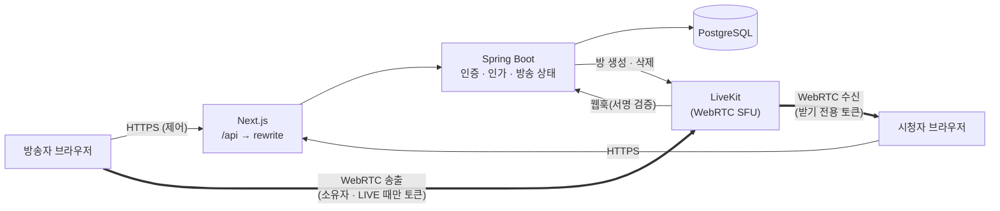

# 지이잉 (live-platform)

PC 화면 공유나 휴대폰 카메라로 라이브 방송을 송출하고, 다른 기기에서 로그인 없이 실시간으로 시청하는 웹 서비스입니다.

| | |
|---|---|
| 서비스 주소 | **https://onair-live-web-28fc2f0d1715.herokuapp.com** |
| 운영 | 상시 운영. 오래 접속이 없었다면 첫 요청이 1~2초 늦을 수 있습니다(DB 대기 해제) |
| 시연 영상 | _(링크 추가 예정)_ |
| 테스트 계정 | 아래 [테스트 계정](#테스트-계정) 참고 |

## 주요 기능

| 영역 | 기능 |
|---|---|
| PC 방송 | 화면(탭 · 창 · 전체 화면) 공유 + 탭/시스템 소리 + 마이크 동시 송출, 송출 중 화면 바꾸기 · 마이크 음소거, 마이크 음량 표시 |
| 모바일 방송 | 휴대폰 카메라 + 마이크 송출, 전면/후면 카메라 전환, 방송 중 화면 꺼짐 방지 |
| 시청 | 목록(방송 중 · 전체 · 종료) → 상세에서 바로 재생, 로그인 불필요, 시청자 수 · 소리 켜기 · 전체 화면 |
| 방송 관리 | 등록 · 수정 · 삭제, 상태 `방송 전 → 방송 중 → 종료`, 종료 시 송출 연결 즉시 끊김, 새로고침해도 30초 안에 "방송 재개" |
| 인증 · 인가 | 회원가입 · 로그인 · 로그아웃(JWT HttpOnly 쿠키), 수정 · 삭제 · 송출 제어는 서버가 소유자 확인 |
| 댓글 (선택) | 방송별 실시간 댓글(SSE), 작성자만 수정, 작성자 · 방송자가 삭제 |

## 테스트 계정

로그인 화면(`/login`)에서 아래 계정으로 로그인하세요. 운영 서버에 일반 회원가입으로 만들어 둔 계정입니다.

| 역할 | 이메일 | 비밀번호 | 용도 |
|---|---|---|---|
| 방송자 | `demo-streamer@example.com` | `jiing2026!` | 방송 만들기 · 송출 |
| 시청자 | `demo-viewer@example.com` | `jiing2026!` | 다른 사용자로 권한 거절 확인 · 댓글 |

회원가입(`/signup`)으로 새 계정을 만들어도 모든 기능을 쓸 수 있습니다.

## 기능 확인 방법

> 송출은 HTTPS(배포 주소) 또는 `localhost`에서만 됩니다(브라우저 보안 정책).

### 1. PC 방송 (PC Chrome · Edge)
1. 방송자 계정으로 로그인 → 첫 화면 **방송 시작하기**(또는 내 방송의 **방송 만들기**) → 제목 입력 후 저장
2. 방송 상세에서 **송출 화면** → 모드 **화면 공유**
3. **화면 선택** → 공유할 대상을 고릅니다
   - 탭 소리: **Chrome 탭**을 고르고 "탭 오디오도 공유"를 켭니다
   - 시스템 소리: Windows에서 **전체 화면**을 고르고 "시스템 오디오도 공유"를 켭니다
4. **마이크 켜기** → 음량 막대가 움직이는지 확인 → **방송 시작**
5. 방송 중: 마이크 음소거, **화면 바꾸기**, 오른쪽 댓글 패널, 제목 옆 시청자 수
6. **방송 종료** → 확인 → 방송자 · 시청자 모두 "방송이 종료되었습니다"

### 2. 모바일 방송 (iOS Safari · Android Chrome)
1. 휴대폰에서 서비스 주소 접속 → 방송자 로그인 → 방송 만들기
2. **송출 화면** → **카메라 켜기**(카메라 · 마이크 권한 허용) → 미리보기 확인
3. **방송 시작** → 방송 중 **전면/후면 전환**으로 카메라 바꾸기
4. **방송 종료**

휴대폰 브라우저는 화면 공유를 지원하지 않아 카메라 모드만 보입니다. PC에서도 **카메라** 모드를 고르면 웹캠으로 송출할 수 있습니다.

### 3. 시청 (다른 기기 · 비로그인)
1. 다른 기기(또는 시크릿 창)에서 서비스 주소 접속 — 로그인하지 않아도 됩니다
2. 첫 화면 **방송 중** 탭에서 방송 선택 → 영상 재생
3. 브라우저가 자동 재생을 막으면 **"눌러서 소리 켜기"** 를 누릅니다
4. 방송자가 종료하면 시청 화면도 바로 종료 화면으로 바뀝니다

### 4. 방송 상태 · 종료 처리
| 상황 | 결과 |
|---|---|
| 방송자가 **방송 종료** | 즉시 `종료`, LiveKit 방을 삭제해 모든 송출 · 시청 연결이 끊김 |
| 방송자가 새로고침 · 잠깐 끊김 | 30초 안에 **방송 재개**를 누르면 이어짐 |
| 방송자가 탭을 닫고 돌아오지 않음 | 30초 유예 뒤 서버가 자동 `종료` |
| 서버 재시작 · 웹훅 유실 | 1분마다 LIVE 방송을 LiveKit과 대조해 방송자가 없으면 `종료` |
| 종료된 방송 | 다시 시작할 수 없음(한 방송 = 한 번의 라이브), 댓글은 읽기 전용 |

### 5. 권한 (서버에서 검증)
| 동작 | 비로그인 | 다른 사용자 | 소유자 |
|---|---|---|---|
| 목록 · 상세 · 시청 | ✅ | ✅ | ✅ |
| 방송 등록 | ❌ 로그인 화면으로 | ✅ | ✅ |
| 수정 · 삭제 · 송출 시작/종료 | ❌ 401 | ❌ 403 | ✅ |
| 댓글 작성 | ❌ 로그인 링크 | ✅ | ✅ |

확인 예: `demo-streamer@example.com`로 방송을 만든 뒤 `demo-viewer@example.com`로 로그인해 그 방송의 `/broadcasts/{id}/edit` 또는 `/studio/{id}`에 들어가면 권한 없음 안내가 나오고, API는 403(`NOT_BROADCAST_OWNER`)을 돌려줍니다. 화면 버튼을 숨기는 것과 별개로 모든 판단은 서버가 합니다.

## 지원 환경

| 기능 | 지원 | 비고 |
|---|---|---|
| PC 화면 공유 | Chrome · Edge (최신) | Firefox · Safari는 화면은 되지만 소리 공유 미지원 |
| 탭 소리 | Chrome · Edge의 **탭** 공유 | |
| 시스템 소리 | **Windows** Chrome · Edge의 **전체 화면** 공유 | macOS는 OS 제약으로 시스템 소리 불가 → 탭 소리 사용 |
| 모바일 송출 | iOS Safari 15+ · Android Chrome | HTTPS 필수 |
| 시청 | 최신 데스크톱 · 모바일 브라우저 | 자동 재생이 막히면 "소리 켜기" 버튼 |

## 기술 스택

| 영역 | 사용 기술 |
|---|---|
| Backend | Java 25, Spring Boot 4.1, Spring Security(JWT HttpOnly 쿠키), Spring Data JPA, PostgreSQL 18, Flyway, springdoc(Swagger) |
| Frontend | Next.js 16 (App Router), React 19, TypeScript, Tailwind CSS 4 |
| Streaming | LiveKit (WebRTC SFU) — `livekit-client`, `@livekit/components-react`, `livekit-server` Java SDK |
| Test | JUnit 5, Testcontainers(PostgreSQL), MockMvc — 104개 |
| Infra | Heroku(컨테이너), Neon(PostgreSQL), LiveKit Cloud, GitHub Actions(CI) |

## 구조



- **제어와 미디어를 분리**했습니다. 로그인 · 방송 CRUD · 송출 시작/종료처럼 권한 판단이 필요한 일은 모두 Spring을 거치고, 영상 · 음성은 브라우저와 LiveKit 사이로만 흐릅니다.
- **송출 권한 = 토큰.** Spring은 소유자이면서 방송이 LIVE일 때만 송출 토큰을 발급하고, 시청 토큰은 받기 전용입니다. 종료하면 LiveKit 방을 지워 연결을 강제로 끊습니다.
- 방송 상태 전이는 엔티티 한 곳(`Broadcast.start()` · `end()`)에만 있고, 상태 변경은 비관적 잠금으로 직렬화합니다. 종료 경로(소유자 · 웹훅 · 유예 만료 · 주기 점검)는 모두 `BroadcastLiveService.endLocked()` 하나를 지납니다.

자세한 설계 문서:
- [`docs/ARCHITECTURE.md`](docs/ARCHITECTURE.md) — 구성도, 요청 경로, 패키지 구조, 배포, 환경변수
- [`docs/DESIGN.md`](docs/DESIGN.md) — ERD, 상태 머신, 인가 표, API 목록, 시퀀스, 결정 이유, 알려진 한계
- [`docs/DEPLOY.md`](docs/DEPLOY.md) — 운영 배포 절차 · 배포 후 확인 · 되돌리기
- [`docs/REQUIREMENTS.md`](docs/REQUIREMENTS.md) — 공모전 요구사항 항목별 구현 상태

API 명세는 백엔드 실행 후 Swagger(`http://localhost:8080/swagger-ui/index.html`)에서 볼 수 있습니다.

## 로컬 실행 방법

### 요구 사항
- JDK 25, Node.js 20 이상(배포 이미지는 24), Docker

### 1. 환경변수
```bash
cp .env.example .env    # 값 설명은 파일 안 주석 참고
```

| 변수 | 설명 | 로컬 기본값 |
|---|---|---|
| `DB_URL` · `DB_USERNAME` · `DB_PASSWORD` | PostgreSQL 접속 | `docker-compose.yml`과 같음 |
| `JWT_SECRET` | JWT 서명 키(32자 이상) | 직접 입력 |
| `COOKIE_SECURE` | HTTPS에서만 쿠키 전송 | 로컬 `false`, 운영 `true` |
| `CORS_ALLOWED_ORIGINS` | 허용할 프론트 주소 | `http://localhost:3000` |
| `LIVEKIT_URL` · `LIVEKIT_API_KEY` · `LIVEKIT_API_SECRET` | LiveKit 서버 | 아래 둘 중 하나 |
| `BACKEND_URL` | 프론트 `/api` 요청을 넘길 주소(빌드 시 읽음) | `http://localhost:8080` |

LiveKit은 둘 중 하나를 고릅니다.
- **로컬 LiveKit 서버(키 발급 불필요)**: `docker compose --profile livekit up -d` → `LIVEKIT_URL=ws://localhost:7880`, `LIVEKIT_API_KEY=devkey`, `LIVEKIT_API_SECRET=secret`
- **LiveKit Cloud**: https://cloud.livekit.io → Settings → Keys에서 발급(무료 플랜으로 충분)

### 2. 실행
```bash
docker compose up -d                       # PostgreSQL (+ --profile livekit 이면 로컬 LiveKit)

cd backend
set -a; . ../.env; set +a                  # 환경변수 불러오기
./gradlew bootRun                          # http://localhost:8080 (Flyway가 테이블 생성)

cd ../frontend
npm ci
npm run dev                                # http://localhost:3000
```

`localhost`는 HTTPS가 아니어도 화면 공유 · 카메라를 쓸 수 있어 PC 송출까지 로컬에서 확인할 수 있습니다. 휴대폰 실기기 송출은 HTTPS가 필요하므로 배포 주소를 사용하세요.

### 3. 테스트
```bash
cd backend && ./gradlew test               # Testcontainers가 PostgreSQL을 띄움 → Docker 실행 필요
cd frontend && npm run lint && npm run build
E2E_BASE_URL=http://localhost:3000 npm run e2e   # 브라우저 E2E (실행 중인 서버 필요, frontend/e2e/README.md)
```

백엔드 테스트는 비로그인 · 소유자 · 다른 사용자별 허용/거절, 상태 전이, 웹훅 서명 위조 · 중복, 방송자 이탈 유예, 주기 정리, 댓글 권한 · SSE를 검증합니다. LiveKit 호출은 테스트용 가짜 구현(`FakeLiveKitRoomClient`)으로 대체합니다. PR마다 GitHub Actions(`.github/workflows/ci.yml`)가 같은 검사를 실행합니다.

브라우저 E2E(`frontend/e2e`, Playwright)는 가짜 카메라 · 마이크로 실제 송출 → 비로그인 시청(영상 · 소리) → 댓글 실시간 수신 → 종료와, 비로그인 · 다른 사용자 권한 거절을 확인합니다. 운영 주소에서 4개 모두 통과했습니다(11-17).

### 운영 배포
```bash
scripts/deploy-heroku.sh [api|web|all]     # Heroku (docker · heroku CLI 로그인 필요)
scripts/self-host.sh up                    # 대안: 한 대에서 DB까지 Docker Compose로 + HTTPS 공개
```
운영 설정 · 배포 후 확인 · 되돌리기는 [`docs/DEPLOY.md`](docs/DEPLOY.md)를 참고하세요.

## 외부 서비스 의존과 대안

| 서비스 | 역할 | 대체 방법 |
|---|---|---|
| LiveKit Cloud | 영상 · 음성 중계(SFU) | LiveKit 서버는 오픈소스(Apache-2.0)라 직접 운영할 수 있습니다. `docker-compose.yml`의 `livekit` 서비스와 같은 이미지를 UDP 포트가 열린 서버에 띄우고 `LIVEKIT_*` 값만 바꾸면 코드 변경 없이 옮겨집니다 |
| Heroku | 프론트 · 백엔드 실행 | `docker-compose.prod.yml` + `scripts/self-host.sh`로 Docker가 있는 어느 서버에서도 DB까지 한 번에 띄울 수 있습니다(11-16 송출 · 시청 검증, `docs/DEPLOY.md` 2절) |
| Neon | PostgreSQL | 표준 PostgreSQL이라 `DB_URL`만 바꾸면 어떤 PostgreSQL로도 옮길 수 있습니다(스키마는 Flyway가 생성) |

## 알려진 한계
- 방송자 이탈 유예와 댓글 SSE 구독은 서버 메모리에 있어 **서버 1대** 기준입니다(여러 대면 Redis pub/sub 필요). 유예 예약이 재시작으로 사라져도 1분 주기 점검이 정리합니다.
- 시청자 수는 3초 간격으로 갱신되어 몇 초 늦을 수 있습니다.
- 세로 카메라 영상은 16:9 플레이어 안에 좌우 여백을 두고 표시됩니다.
- 선택 기능 중 도네이션 · 녹화는 구현하지 않았습니다.

## 오픈소스 및 출처
- [LiveKit](https://github.com/livekit/livekit) (Apache-2.0) — 미디어 서버(LiveKit Cloud · 로컬 `livekit/livekit-server` 이미지)
- [livekit-client](https://github.com/livekit/client-sdk-js) · [@livekit/components-react](https://github.com/livekit/components-js) (Apache-2.0) — 브라우저 송출 · 시청
- [livekit-server-sdk-kotlin](https://github.com/livekit/server-sdk-kotlin) (Apache-2.0) — 백엔드 토큰 발급 · 방 관리 · 웹훅 검증
- [Pretendard](https://github.com/orioncactus/pretendard) (SIL OFL-1.1) — 글꼴, jsDelivr CDN으로 로드
- [Spring Boot](https://spring.io/projects/spring-boot) · [Next.js](https://nextjs.org) · [jjwt](https://github.com/jwtk/jjwt) · [springdoc-openapi](https://springdoc.org) · [Testcontainers](https://testcontainers.com) 등 각 라이브러리는 해당 라이선스를 따릅니다
- 개발에 AI 도구(Claude Code)를 활용했습니다
