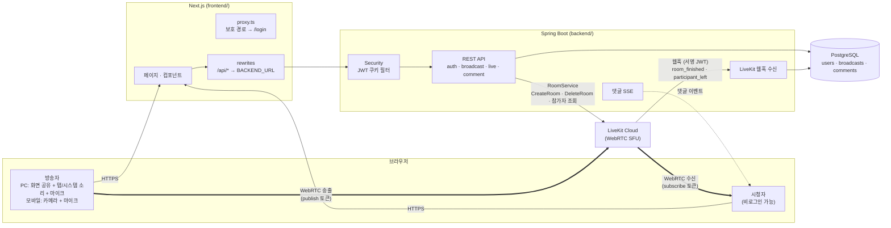
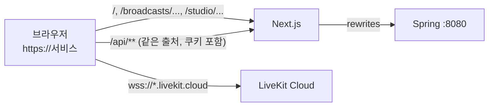
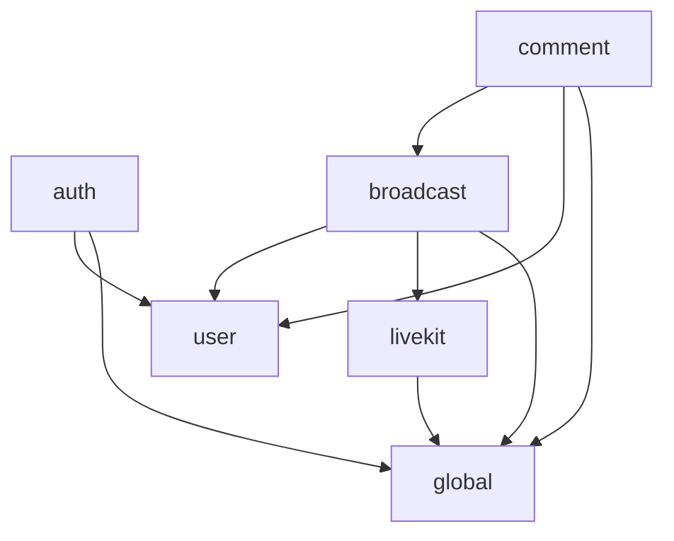
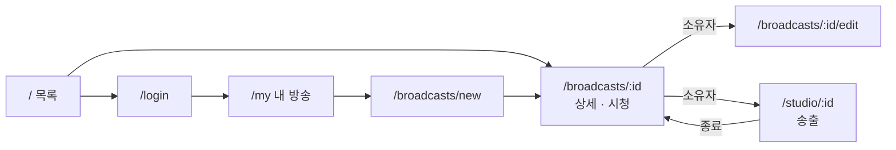
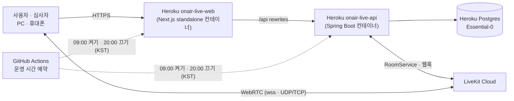

# 아키텍처 — 핏(live-platform)

실시간 라이브 방송을 송출 · 시청하는 웹 서비스의 시스템 구성과 코드 구조를 정리한다.
도메인 설계(상태 · 권한 · API · 흐름)는 [`DESIGN.md`](DESIGN.md), 요구사항별 진행 상태는 [`REQUIREMENTS.md`](REQUIREMENTS.md)를 본다.

- 기준: 2026-11-12, 브랜치 `feature/live/#7-pc-broadcast`
- 표기: **(예정)** 은 아직 구현하지 않은 부분

## 1. 기술 스택

| 영역 | 선택 | 이유 |
|---|---|---|
| 프론트엔드 | Next.js 16 (App Router, TypeScript, Tailwind 4) · `livekit-client` · `@livekit/components-react` | 화면 공유 · 카메라 · WebRTC는 브라우저에서 일어나므로 SPA 성격이 강하다. `/api` rewrites로 백엔드와 같은 출처를 만들어 쿠키 인증을 단순하게 유지 |
| 백엔드 | Java 25 · Spring Boot 4.1.2 · Spring Security · JPA · Flyway · springdoc | 인증 · 인가 · 방송 상태 관리 · LiveKit 제어를 맡는 API 서버 |
| DB | PostgreSQL 18 | 방송 정보 영구 저장(재시작 후 조회). 스키마는 Flyway 마이그레이션으로 관리 |
| 스트리밍 | **LiveKit Cloud** (WebRTC SFU) | 미디어 서버를 직접 운영하지 않고 1:N 저지연 송출을 얻는다. 서버는 토큰 발급 · 방 생성/삭제 · 웹훅만 담당 |
| 테스트 | JUnit 5 · Testcontainers PostgreSQL · MockMvc · Playwright(E2E, 저장소 밖) | 실제 DB로 통합 테스트, LiveKit은 가짜 클라이언트로 대체 |
| CI | GitHub Actions | PR마다 백엔드 `./gradlew test` + 프론트 lint · build |
| 배포 | Heroku 컨테이너(프론트 · 백엔드 앱 2개, Basic 다이노) + Heroku Postgres Essential-0 (#9) | HTTPS 자동(모바일 카메라 · 화면 공유는 보안 컨텍스트에서만 동작). GitHub 학생 크레딧 사용 |

## 2. 시스템 구성도



핵심은 **제어와 미디어를 나눈 것**이다.

- **제어 경로**(얇은 선): 브라우저 → Next.js → Spring. 로그인, 방송 CRUD, 송출 시작 · 종료, 토큰 발급처럼 권한 판단이 필요한 일은 모두 Spring을 거친다.
- **미디어 경로**(굵은 선): 브라우저 ↔ LiveKit. 영상 · 음성은 Spring을 지나지 않는다. Spring이 발급한 토큰에 담긴 권한(방 이름 · 송출 가능 여부)만 LiveKit이 확인한다.
- 따라서 "누가 송출할 수 있는가"는 Spring이 토큰 발급 시점에 결정하고, "송출을 강제로 끊는다"는 Spring이 LiveKit 방을 삭제해서 처리한다.

## 3. 요청 경로와 출처



- 브라우저는 항상 **같은 출처의 `/api/**`** 만 호출한다. Next.js가 `BACKEND_URL`로 넘기므로 CORS와 서드파티 쿠키 문제를 피한다.
- 인증 쿠키 `access_token`은 HttpOnly · SameSite=Lax(운영은 Secure)다. CSRF 토큰 대신 SameSite로 막는다.
- LiveKit 접속은 백엔드가 응답한 `serverUrl`(wss)로 브라우저가 직접 연결한다.

## 4. 저장소 구조

```
live-platform/
├── backend/                  Spring Boot API 서버
├── frontend/                 Next.js 웹 앱
├── docs/                     요구사항 · 아키텍처 · 설계 문서
├── .github/                  CI(workflows/ci.yml), 이슈 · PR 템플릿
├── docker-compose.yml        로컬 PostgreSQL (+ 선택: 로컬 LiveKit dev 서버, profile livekit)
├── .env.example              환경변수 예시 (실제 .env는 커밋 금지)
├── PROGRESS.md               작업 진행 기록
└── README.md                 실행 방법 · 기능 확인 절차 (#14에서 완성)
```

### 4.1 백엔드 패키지 (`backend/src/main/java/com/gy/live`)

도메인별 패키지(package-by-feature) + 공통 `global`.

```
com.gy.live
├── auth/            회원가입 · 로그인 · 테스트 로그인 · 로그아웃 · 내 정보
│   ├── AuthController, AuthService
│   ├── TestAccount, TestAccountInitializer   심사용 계정을 시작 시 생성
│   └── dto/
├── user/            User 엔티티 · UserRepository
├── broadcast/       방송 정보와 라이브 상태
│   ├── Broadcast (엔티티 · 상태 전이 start/end/checkLive/checkDeletable)
│   ├── BroadcastStatus (READY · LIVE · ENDED)
│   ├── BroadcastController / BroadcastService            CRUD, 소유자 확인 findOwned
│   ├── BroadcastLiveController / BroadcastLiveService    start · publisher-token · end · viewer-token
│   ├── LiveKitWebhookController                          room_finished · participant_left 처리
│   ├── BroadcastEndedEvent                               종료 시 발행(댓글 SSE 종료 등)
│   └── dto/
├── comment/         방송별 댓글 + SSE
│   ├── CommentController, CommentService, CommentRepository, Comment
│   ├── CommentEvent       커밋 뒤(AFTER_COMMIT) SSE로 전파
│   └── CommentStreams     방송별 SseEmitter 구독 목록(메모리)
├── livekit/         외부 시스템 경계(LiveKit)
│   ├── LiveKitRoomClient (인터페이스) ← SdkLiveKitRoomClient (테스트는 Fake로 대체)
│   ├── LiveKitTokenIssuer     송출/시청 토큰과 권한(grant)
│   ├── LiveKitWebhookVerifier 웹훅 서명 · 본문 해시 검증
│   ├── RoomNames              방 · 참가자 이름 규칙
│   └── LiveKitConfig, LiveKitException
└── global/
    ├── config/     AppProperties(app.*), PasswordConfig
    ├── security/   SecurityConfig, JwtProvider, JwtAuthenticationFilter, AuthCookies, LoginUser, SecurityErrorHandlers
    ├── error/      ErrorCode, BusinessException, ErrorResponse{code,message}, GlobalExceptionHandler
    └── web/        PageResponse
```

의존 방향:



- `livekit` 패키지는 도메인을 모른다(방 이름 규칙 · 토큰 · 방 API만). LiveKit SDK는 이 패키지 안에만 있다.
- `comment`는 `broadcast`의 `BroadcastEndedEvent`를 구독할 뿐, 방송 쪽은 댓글을 모른다.

DB 마이그레이션: `resources/db/migration/V1__create_users.sql` · `V2__create_broadcasts.sql` · `V3__create_comments.sql` (`ddl-auto: validate`).

### 4.2 프론트엔드 구조 (`frontend/src`)

```
src/
├── proxy.ts                       (Next 16의 middleware) 보호 경로에 쿠키 없으면 /login?next=
├── app/                           라우트
│   ├── layout.tsx                 AuthProvider · Header · Pretendard 글꼴(CDN)
│   ├── page.tsx                   / 방송 목록
│   ├── login/ · signup/           로그인 · 회원가입
│   ├── my/                        내 계정 · 내 방송 목록                        [로그인]
│   ├── broadcasts/new/            방송 등록                                     [로그인]
│   ├── broadcasts/[id]/           방송 상세 · 시청                              [공개]
│   ├── broadcasts/[id]/edit/      방송 수정                                     [소유자]
│   └── studio/[id]/               송출 스튜디오(PC 화면 공유 · 카메라)        [소유자]
├── components/
│   ├── auth/       AuthProvider(useAuth) · RequireAuth · LoginForm · SignupForm
│   ├── broadcast/  BroadcastList · BroadcastCard · BroadcastDetail · LivePlayer · BroadcastForm
│   │               CreateBroadcast · EditBroadcast · DeleteBroadcast · MyBroadcasts · OwnerActions · StatusBadge
│   │               OwnerAvatar · useViewerCount(시청자 수)
│   ├── comment/    CommentPanel · CommentComposer · CommentItem · useComments(목록 리듀서 + SSE)
│   ├── studio/     Studio(UI · 댓글 패널 · 마이크 음량) · useBroadcastSession(연결 상태 머신) · media(화면 · 카메라 · 마이크 캡처) · useWakeLock
│   └── Header · Logo · ui
└── lib/
    ├── api.ts          fetch 래퍼 api<T>(), ApiError{status, code, message}
    ├── broadcast.ts    타입 · 상태 라벨 · 시간 포맷 · loadBroadcast
    ├── comments.ts     댓글 타입 · 리듀서 · 조회
    └── navigation.ts   safeNext(오픈 리다이렉트 방지) · loginPath
```

화면 이동:



## 5. 배포 구성 (#9)



- 서비스: https://onair-live-web-28fc2f0d1715.herokuapp.com (백엔드: https://onair-live-api-daf462a2a9af.herokuapp.com)
- 앱 2개 모두 Heroku 컨테이너 스택(US 리전), Basic 다이노(메모리 512MB, 잠들지 않음). 이미지는 `backend/Dockerfile` · `frontend/Dockerfile`, 배포는 `scripts/deploy-heroku.sh [api|web|all]`(로컬 Docker로 linux/amd64 빌드 → Heroku 레지스트리 푸시 → release).
  - Heroku 레지스트리는 Docker v2 매니페스트만 받는다. buildx 기본 OCI 형식 · 출처 증명은 `unsupported`로 거절 → `oci-mediatypes=false`, `--provenance=false`.
  - 프론트는 `output: "standalone"`. `BACKEND_URL`은 빌드 인자로 넣는다(rewrites가 빌드 시점에 읽음).
  - 백엔드는 `docker-entrypoint.sh`가 Heroku의 `DATABASE_URL`(postgres://)을 JDBC `DB_URL` · `DB_USERNAME` · `DB_PASSWORD`로 바꾼다(`sslmode=require`). 포트는 `PORT`.
  - 512MB 안에 들도록 `JAVA_TOOL_OPTIONS`(힙 45% · SerialGC · 코드 캐시 48m · 메타스페이스 160m · C1만) + Tomcat 스레드 40. 처음 설정(힙 70%)은 R14 메모리 초과가 났다.
- **운영 시간 오전 9시 ~ 오후 8시(KST)**: `.github/workflows/dyno-schedule.yml`이 다이노를 1 ↔ 0으로 바꾼다(비용 절감, 사용자 결정). 이 시간 밖에는 접속할 수 없다. 수동 실행(workflow_dispatch)으로 언제든 켜고 끌 수 있다. 저장소 시크릿 `HEROKU_API_KEY`는 write 범위 전용 토큰. DB는 항상 켜져 있다.
- 운영 환경변수(백엔드): `DATABASE_URL`(애드온), `JWT_SECRET`(무작위), `COOKIE_SECURE=true`, `CORS_ALLOWED_ORIGINS`(프론트 주소), `TEST_ACCOUNTS_ENABLED=true`, `JAVA_TOOL_OPTIONS`, `SERVER_TOMCAT_THREADS_MAX`, `LIVEKIT_*`.
- LiveKit Cloud 프로젝트의 웹훅 URL을 `https://onair-live-api-daf462a2a9af.herokuapp.com/api/livekit/webhook`으로 등록해야 비정상 종료가 정리된다.
- 댓글 SSE는 Heroku 라우터 · Next rewrite를 거쳐도 버퍼링 없이 도착함을 확인(첫 이벤트 즉시, 20초 `:ping`). Heroku 라우터 유휴 제한(55초)보다 ping 간격이 짧다.
- 녹화 **(예정, #13)**: LiveKit Egress → S3 호환 스토리지.

## 6. 설정 · 환경변수

| 키 | 기본값(로컬) | 설명 |
|---|---|---|
| `DB_URL` · `DB_USERNAME` · `DB_PASSWORD` | `jdbc:postgresql://localhost:5432/live` · `live` · `live` | PostgreSQL |
| `JWT_SECRET` · `JWT_ACCESS_TOKEN_TTL` | 개발용 문자열 · `12h` | 인증 토큰 |
| `COOKIE_SECURE` | `false` | 운영(HTTPS)에서는 `true` |
| `TEST_ACCOUNTS_ENABLED` · `TEST_ACCOUNT_PASSWORD` | `true` · `test1234!` | 심사용 계정 자동 생성 |
| `CORS_ALLOWED_ORIGINS` | `http://localhost:3000` | 직접 호출 허용 출처 |
| `LIVEKIT_URL` · `LIVEKIT_API_KEY` · `LIVEKIT_API_SECRET` | 비어 있음 | 비어 있으면 라이브 API가 503 `LIVEKIT_NOT_CONFIGURED` |
| `BACKEND_URL` (프론트) | `http://localhost:8080` | `/api` rewrites 대상, **빌드 시점**에 읽힘 |

고정 설정(`app.livekit.*`): 빈 방 유지 `empty-timeout` 2분 · 마지막 참가자 이탈 후 `departure-timeout` 1분 · 방송자 이탈 유예 `broadcaster-grace` 30초 · 토큰 수명 `token-ttl` 1시간.
