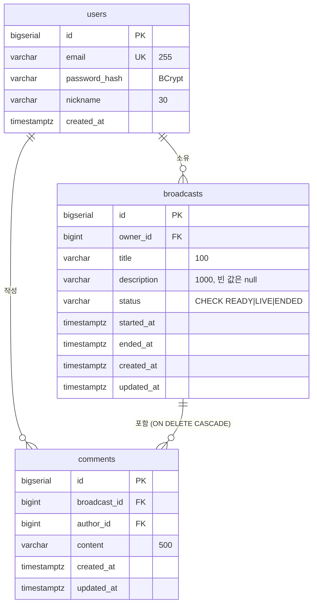
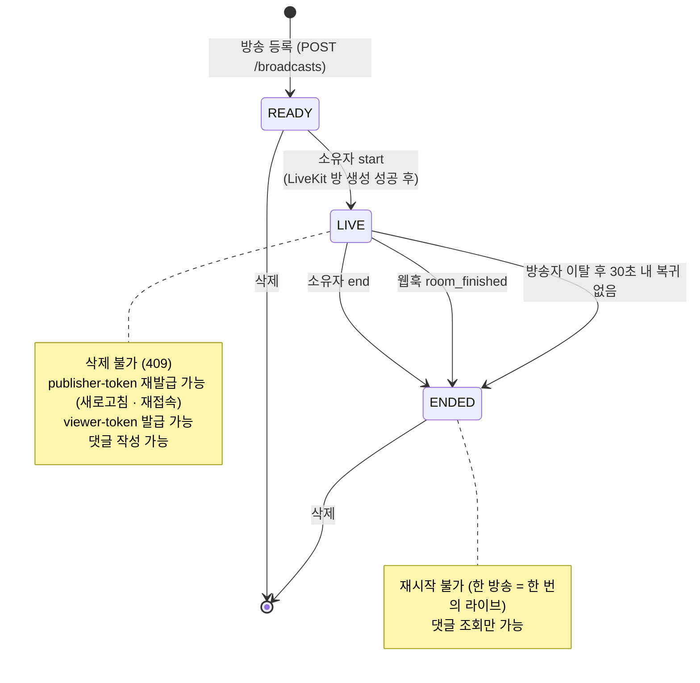
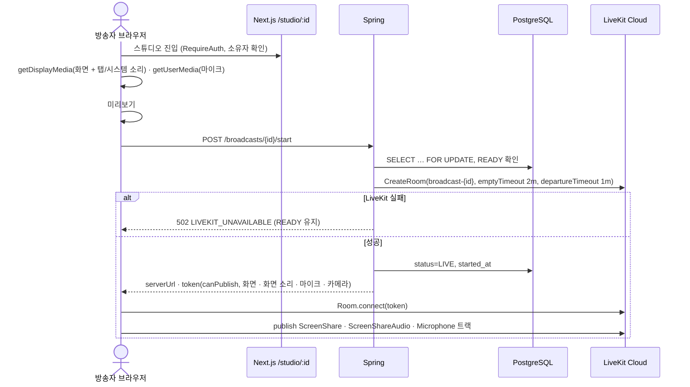
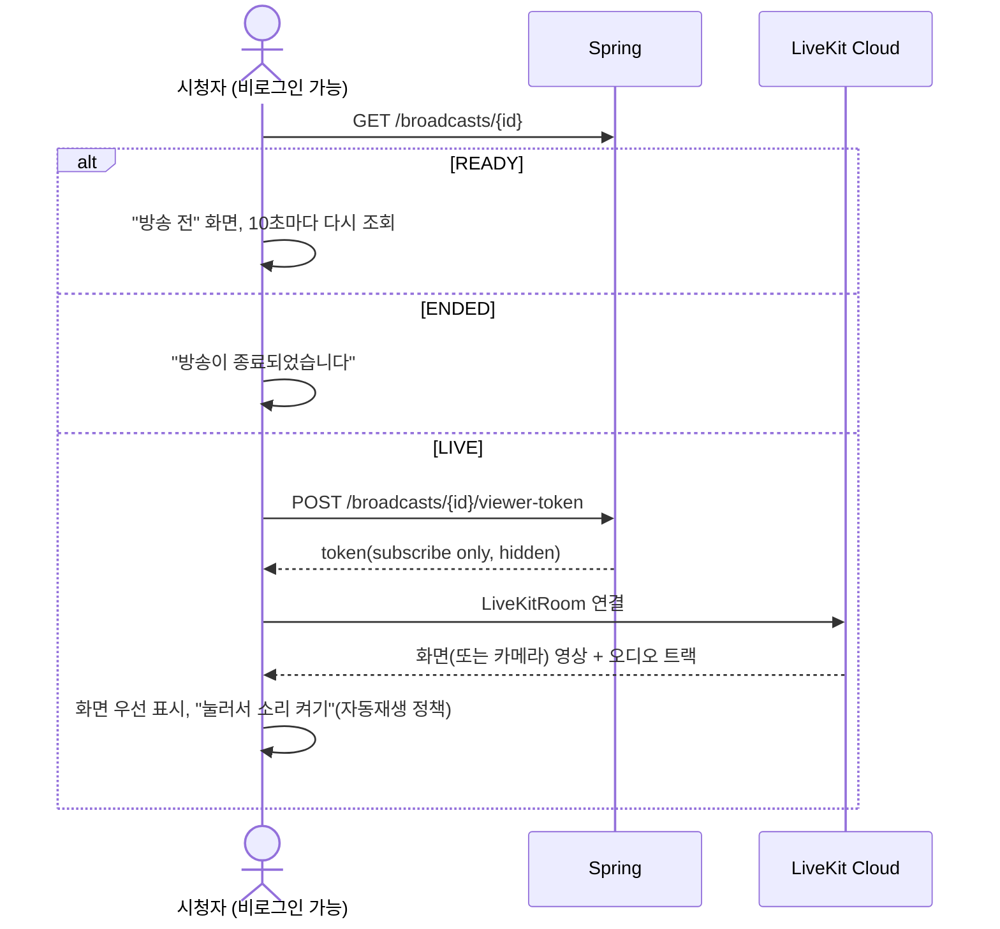
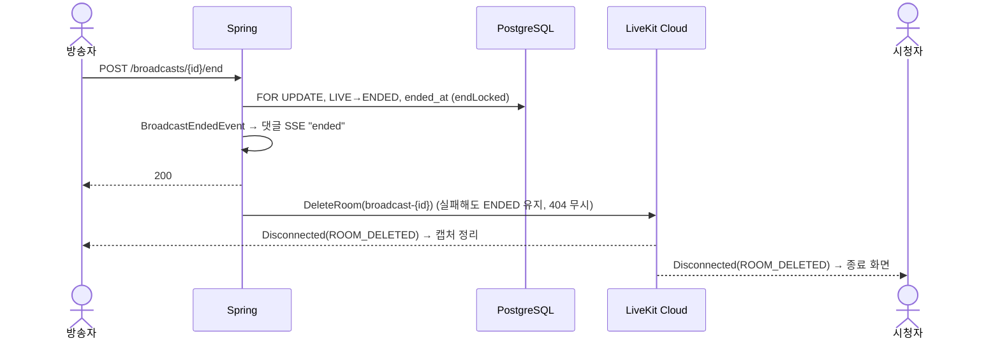
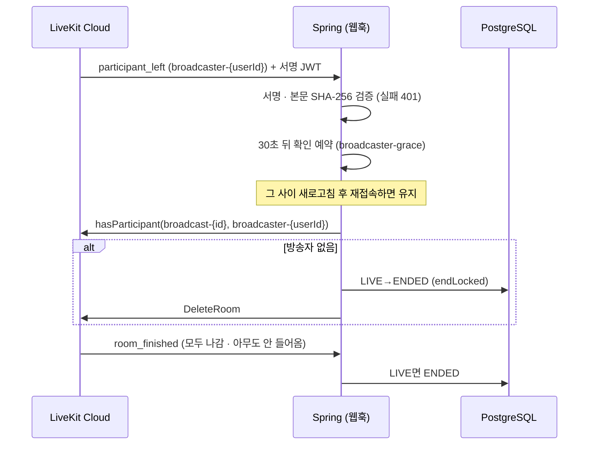
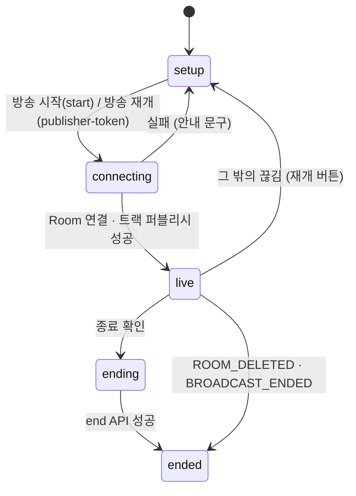
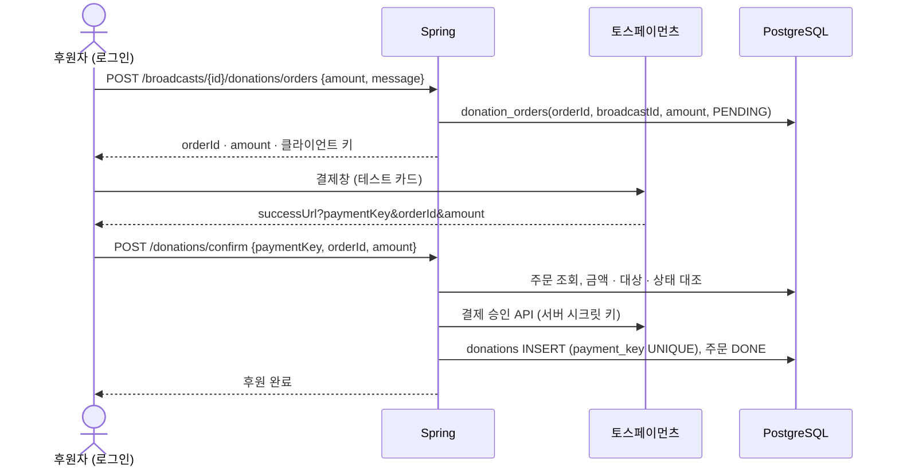

# 설계 — 온에어(live-platform)

도메인 모델, 방송 상태, 권한, API, 주요 흐름과 결정 이유를 정리한다.
시스템 구성과 코드 구조는 [`ARCHITECTURE.md`](ARCHITECTURE.md)를 본다.

- 기준: 2026-11-12. **(예정)** 은 아직 구현하지 않은 부분

## 1. 데이터 모델

인덱스: `broadcasts(status, created_at desc)` 목록 필터, `broadcasts(owner_id, created_at desc)` 내 방송, `comments(broadcast_id, id desc)` 댓글 커서.

LiveKit 쪽 이름은 DB에 저장하지 않고 규칙으로 만든다(`RoomNames`): 방 `broadcast-{id}`, 방송자 `broadcaster-{userId}`, 시청자 `viewer-{uuid}`.

## 2. 방송 상태 머신

- 전이 규칙은 엔티티 `Broadcast`에만 있다: `start()`(READY→LIVE), `end()`(LIVE→ENDED), `checkLive()`, `checkDeletable()`. 어긋나면 409(`BROADCAST_ALREADY_LIVE` · `BROADCAST_NOT_LIVE` · `BROADCAST_ENDED` · `BROADCAST_LIVE_CANNOT_DELETE`).
- 상태 변경은 `findForUpdateById`(비관적 잠금)로 직렬화한다. 소유자 종료와 웹훅 종료가 동시에 와도 한 번만 ENDED가 된다.
- 종료는 모두 `BroadcastLiveService.endLocked()` 한 곳을 지나며 `BroadcastEndedEvent`를 발행한다. 종료 경로가 몇 개든 후처리(댓글 SSE `ended`, 녹화 정리 예정)는 한 곳에서 걸린다.
- 종료 API는 멱등이다. 이미 ENDED면 200을 그대로 돌려준다.

## 3. 인증 · 인가

### 3.1 인증

- 로그인 성공 시 JWT를 **HttpOnly 쿠키 `access_token`** 으로 내린다(SameSite=Lax, 운영 Secure). `Authorization: Bearer`도 허용한다(Swagger · 테스트용).
- 비밀번호는 BCrypt. 로그아웃은 쿠키를 `Max-Age=0`으로 지운다(무상태, 서버 세션 없음).
- 심사용 테스트 계정 `streamer@test.com` · `viewer@test.com`(비밀번호 `test1234!`)을 시작 시 만들고, 로그인 화면의 버튼(`POST /api/auth/test-login`)으로 바로 로그인한다.
- 프론트: `proxy.ts`가 쿠키 유무만 보고 보호 경로를 `/login?next=`로 보낸다(빠른 1차 차단). 실제 판단은 서버가 한다. `safeNext`로 오픈 리다이렉트를 막는다.

### 3.2 인가 규칙 (서버에서 검증)

| 동작 | 비로그인 | 로그인(다른 사용자) | 방송 소유자 |
|---|---|---|---|
| 방송 목록 · 상세 조회 | ✅ | ✅ | ✅ |
| 시청 토큰 발급 (LIVE만) | ✅ | ✅ | ✅ |
| 방송 등록 | ❌ 401 | ✅ | ✅ |
| 방송 수정 · 삭제 | ❌ 401 | ❌ 403 | ✅ |
| 송출 시작 · 재접속 토큰 · 종료 | ❌ 401 | ❌ 403 | ✅ |
| 댓글 목록 · SSE 구독 | ✅ | ✅ | ✅ |
| 댓글 작성 (LIVE만) | ❌ 401 | ✅ | ✅ |
| 댓글 수정 | ❌ 401 | 작성자만 | 작성자만 |
| 댓글 삭제 | ❌ 401 | 작성자만 | 작성자 또는 방송 소유자 |

- 1차: `SecurityConfig` — 공개 경로는 인증 POST 4개, `GET /api/broadcasts/**`, `POST …/viewer-token`, 웹훅, health, Swagger. 나머지는 인증 필요.
- 2차: 서비스 계층 — 소유자 확인은 `BroadcastService.findOwned(userId, id)` 한 곳으로 모았다(없으면 404, 남의 것이면 403 `NOT_BROADCAST_OWNER`).
- 3차: LiveKit 토큰 권한 — 송출 토큰은 소유자에게 LIVE일 때만 발급되고, 시청 토큰은 `canPublish=false` · `hidden`이다. 시청자가 토큰을 조작해 송출할 수 없다.
- 각 행은 `BroadcastControllerTest` · `BroadcastLiveControllerTest` · `CommentControllerTest`에서 비로그인/소유자/타인 별로 검증한다.

### 3.3 오류 형식

모든 오류는 `{ "code": "BROADCAST_NOT_FOUND", "message": "…" }`. `ErrorCode` enum이 HTTP 상태와 메시지를 가진다. 프론트는 `ApiError{status, code, message}`로 받아 코드별로 안내한다.

## 4. API

| 메서드 · 경로 | 권한 | 설명 |
|---|---|---|
| `POST /api/auth/signup` · `login` · `test-login` · `logout` | 공개 | 쿠키 발급 · 삭제 |
| `GET /api/auth/me` | 로그인 | 내 정보 |
| `POST /api/broadcasts` | 로그인 | 등록 → 201 + Location, 상태 READY |
| `GET /api/broadcasts?status=&ownerId=&page=&size=` | 공개 | 최신순, size ≤ 50, `PageResponse` |
| `GET /api/broadcasts/{id}` | 공개 | 상세 |
| `PATCH` · `DELETE /api/broadcasts/{id}` | 소유자 | 수정 · 삭제(LIVE 삭제 409) |
| `POST /api/broadcasts/{id}/start` | 소유자 | READY→LIVE, 방 생성, 송출 토큰 |
| `POST /api/broadcasts/{id}/publisher-token` | 소유자 | LIVE 재접속용 송출 토큰 |
| `POST /api/broadcasts/{id}/end` | 소유자 | LIVE→ENDED, 방 삭제(멱등) |
| `POST /api/broadcasts/{id}/viewer-token` | 공개 | LIVE만, 받기 전용 토큰 |
| `POST /api/livekit/webhook` | LiveKit 서명 | room_finished · participant_left |
| `GET /api/broadcasts/{id}/comments?before=&size=` | 공개 | 최신순 커서 `{items, hasNext, nextBefore}` |
| `GET /api/broadcasts/{id}/comments/stream` | 공개 | SSE: `comment` · `comment-updated` · `comment-deleted` · `ended` |
| `POST /api/broadcasts/{id}/comments` | 로그인 | LIVE만 |
| `PATCH` · `DELETE /api/broadcasts/{id}/comments/{cid}` | 작성자(삭제는 + 방송 소유자) | |

라이브 응답 `LiveAccessResponse{serverUrl, roomName, identity, token, broadcast}`. 상세 명세는 실행 후 Swagger(`/swagger-ui/index.html`).

## 5. 주요 흐름

### 5.1 송출 시작 (PC)

- 외부 호출(LiveKit)은 DB 트랜잭션 밖에서 한다. 방 생성이 성공해야만 LIVE가 되므로 "LIVE인데 방이 없는" 상태가 생기지 않는다.
- 화면 소리와 마이크는 **믹싱하지 않고 별도 트랙**으로 보낸다. 시청자 쪽 `RoomAudioRenderer`가 두 트랙을 함께 재생한다. 브라우저 오디오 그래프를 다루지 않아도 되고, 마이크 음소거가 화면 소리에 영향을 주지 않는다.
- 탭 소리는 Chrome · Edge 탭 공유에서, 시스템 소리는 Windows Chrome · Edge 화면 전체 공유에서만 브라우저가 제공한다(macOS 시스템 소리 불가). README 지원 환경에 명시한다.
- 새로고침 · 일시 이탈: LIVE면 스튜디오가 "방송 재개"를 보여 주고 `publisher-token`으로 다시 연결한다.

### 5.2 시청

### 5.3 종료와 송출 중단

방 삭제가 곧 **송출 강제 중단**이다. 방송자가 다시 붙으려 해도 `publisher-token`이 ENDED에서 409이므로 재송출할 수 없다.

### 5.4 비정상 종료 정리 (탭 닫기 · 네트워크 끊김)

- 유예 예약은 메모리 스케줄러라 서버가 재시작되면 사라진다. 이 경우 LiveKit의 `emptyTimeout`(2분) · `departureTimeout`(1분)으로 방이 닫히며 오는 `room_finished`가 최종 안전망이다.
- 웹훅은 중복 · 순서 뒤바뀜에도 안전하다(상태 전이가 LIVE일 때만 일어남).

### 5.5 댓글 실시간 전송

- 작성 시 방송 행을 `FOR SHARE`로 잠가, 종료 커밋 뒤에 댓글이 생기지 않게 한다.
- 이벤트는 `@TransactionalEventListener(AFTER_COMMIT)`로 커밋된 것만 SSE로 보낸다. 구독 목록은 메모리(`CommentStreams`), 30분 타임아웃, 20초 `:ping`, `retry: 3000`, `X-Accel-Buffering: no`.
- 종료 시 `ended` 이벤트를 보내고 스트림을 닫는다. 이미 종료된 방송을 구독하면 즉시 `ended`.
- 프론트 댓글 UI **(예정)**: 첫 페이지 조회 + SSE 구독, 재연결 시 첫 페이지를 다시 받아 id로 합친다.

## 6. 송출 스튜디오 클라이언트 설계

`useBroadcastSession`의 상태:

- 캡처(`media.ts`): `Capture{screen, screenAudio, mic, micMuted}`. 화면 선택 취소는 null, 마이크 실패도 null(화면만으로 송출 가능).
- 브라우저의 "공유 중지"를 누르면 방 연결은 유지하고 화면만 다시 고르게 한다.
- 화면을 떠나거나 `<Activity>`로 숨겨지면 연결 · 캡처를 모두 정리한다(숨은 탭에서 화면을 계속 캡처하지 않기 위해). 종료 API는 부르지 않으므로 30초 안에 돌아오면 재개, 아니면 서버 유예로 자동 종료.
- 늦게 도착한 비동기 결과는 epoch 카운터로 버린다.

### 6.1 모바일 송출 (#8)

- 송출 방식 `StudioMode = "screen" | "camera"`, 캡처는 `Capture{ video?: VideoCapture, mic?, micMuted }`이고 `VideoCapture`는 `{kind:"screen", track, audio?}` 또는 `{kind:"camera", track, facing}`이다.
- 휴대폰(`getDisplayMedia` 없음)은 카메라만. PC는 기본 화면 공유이고 setup 단계에서 "화면 공유 | 카메라"로 웹캠을 고를 수 있다. 둘 다 없으면(HTTPS 아님 등) HTTPS · 지원 브라우저 안내.
- 카메라는 `createLocalVideoTrack({facingMode, 720p})`, 마이크는 카메라를 켤 때 함께 요청한다. 미리보기는 전면 카메라일 때만 CSS로 거울 반전(송출 트랙은 그대로).
- 전면/후면 전환은 `restartTrack({facingMode})` — 같은 퍼블리케이션을 유지해 방송 중에도 시청자 연결이 끊기지 않는다. 버튼은 휴대폰에서만 보인다.
- 방송 중 카메라가 끊기면(앱 전환 등) LiveKit SDK가 같은 트랙으로 다시 잡고, 실패하면 음소거한다(`LocalParticipant.handleTrackEnded`). 우리 코드는 방송 전(setup)에만 미리보기를 비운다.
- 연결 · 방송 · 종료 중에는 Screen Wake Lock으로 화면 꺼짐을 막고, 탭이 다시 보이면 다시 요청한다(`useWakeLock`).
- 서버 변경 없음 — 송출 토큰에 camera · microphone 권한이 있고, 시청 화면은 ScreenShare 다음으로 Camera 트랙을 고른다.

## 7. 선택 기능 설계 (예정)

### 7.1 도네이션 (#12, 토스페이먼츠 테스트 모드)

- 금액 · 대상은 **서버에 저장한 주문**과 대조한다(클라이언트 값 불신).
- 같은 승인 통지가 반복돼도 `payment_key` · `order_id` 유니크 제약과 주문 상태 확인으로 한 번만 적립한다.
- 방송별 후원 내역 · 합계 조회 API, 상세 화면에 합계 표시.

### 7.2 녹화 · 다시보기 (#13)

- 송출 시작 시 LiveKit Room Composite Egress로 녹화를 시작하고, 종료(`BroadcastEndedEvent`) 때 멈춘다. 결과 파일은 S3 호환 스토리지에 저장한다.
- `recordings(id, broadcast_id, egress_id, status, file_url, duration, created_at)`에 위치를 저장하고 `egress_ended` 웹훅으로 완료 처리한다.
- 녹화 목록 · 상세 화면에서 `<video>`로 재생한다.

## 8. 주요 결정과 이유

| 결정 | 이유 | 대안 |
|---|---|---|
| LiveKit Cloud (SFU) 사용 | 미디어 서버 운영 없이 저지연 1:N, 화면 공유 오디오 · 모바일 브라우저 지원이 SDK에 있다 | 직접 WebRTC(P2P는 시청자 수 한계), RTMP/HLS(지연 수 초, 브라우저 송출 어려움) |
| 제어는 Spring, 미디어는 LiveKit | 권한 판단을 한 서버에 모으고 미디어 부하는 SFU에 맡긴다 | — |
| 방 생성은 시작 시점, 방 삭제로 송출 중단 | 송출 권한이 "LIVE 상태"와 항상 일치. 종료 즉시 모든 연결이 끊긴다 | 토큰 만료만으로 차단(즉시 끊기지 않음) |
| JWT를 HttpOnly 쿠키로 | XSS로 토큰을 읽을 수 없고, 같은 출처 rewrites와 함께 쓰면 CORS · CSRF 처리가 단순 | localStorage + Bearer |
| 화면 소리 · 마이크 별도 트랙 | 믹싱 코드 없이 두 소리를 동시에 전달, 개별 음소거 가능 | WebAudio 믹싱 후 단일 트랙 |
| 한 방송 = 한 번의 라이브 (ENDED 재시작 불가) | 상태 단순화, 녹화 · 후원 · 댓글이 한 회차에 묶인다 | 재시작 허용 |
| 방송자 이탈 30초 유예 | 새로고침 · 순간 끊김에 방송이 끝나지 않게 | 즉시 종료 |
| 패키지를 도메인별로 | 기능 단위로 읽고 테스트하기 쉽다. 외부 시스템은 `livekit/` 경계에 격리 | 계층별 패키지 |

## 9. 알려진 한계

- 유예 예약 · 댓글 SSE 구독은 서버 메모리에 있어 **서버 1대**를 전제로 한다. 여러 대로 늘리면 pub/sub(예: Redis)이 필요하다.
- `start` 요청 중 화면을 떠나면 서버는 LIVE인데 방송자가 없을 수 있다 → `emptyTimeout`(2분) 뒤 `room_finished`로 ENDED.
- 댓글 레이트 리밋 없음.
- 시스템 소리는 브라우저 · OS 제약(Windows Chrome/Edge만)을 따른다.
